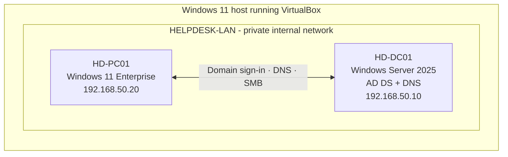
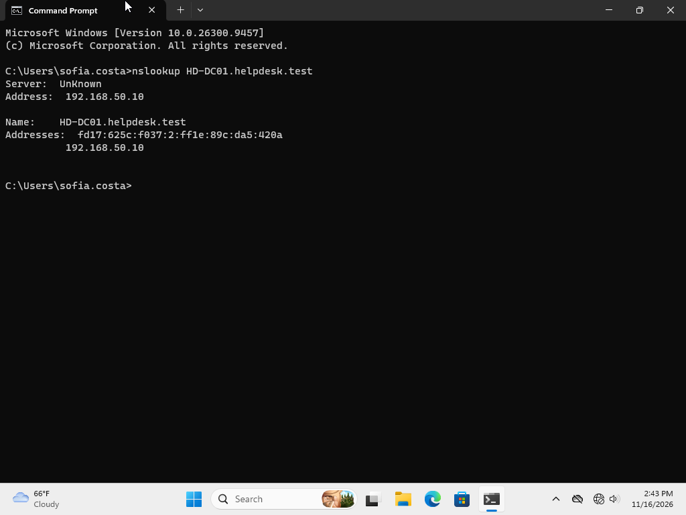

Active Directory Home Lab

**Windows Server 2025 • Windows 11 Enterprise • Active Directory • DNS • Group Policy • SMB • NTFS**

A hands-on IT support lab built in Oracle VirtualBox to simulate an organization with ten employees across IT, HR, Sales, and Finance. I deployed a Windows Server domain controller and a domain-joined Windows 11 workstation, then practiced common Help Desk Level 1 support scenarios: password resets, account lockouts, file-share permissions, group membership issues, and DNS troubleshooting.

> **Scope:** This is an isolated, self-directed training environment—not employment experience or a production deployment. Names and users are fictional. Windows evaluation editions are used for learning.

## Lab at a glance

| Component | Configuration |
| --- | --- |
| Hypervisor | Oracle VirtualBox |
| Domain controller | `HD-DC01` — Windows Server 2025 Standard Evaluation |
| Client workstation | `HD-PC01` — Windows 11 Enterprise Evaluation |
| AD DS domain | `helpdesk.test` |
| Internal lab network | `HELPDESK-LAN` (VirtualBox Internal Network) |
| Domain controller internal IPv4 | `192.168.50.10/24` |
| Client internal IPv4 | `192.168.50.20/24` |
| Client domain DNS server | `192.168.50.10` |
| Organizational units | Employees → IT, HR, Sales, Finance |
| Test identities | 10 fictional employee accounts |
| Security group | `GG_HR_Shared_RW` (Global / Security) |
| HR file share | `\\HD-DC01\HR` |

## Architecture



The VMs also used a separate NAT adapter during some setup steps. To avoid using the wrong name server for domain operations, the Windows 11 client's internal adapter was configured to use the domain controller's IP for DNS.

## What I configured

- Installed a Windows Server 2025 virtual machine, promoted it to the `helpdesk.test` domain controller, and configured DNS.
- Created the `Employees` OU, four department OUs, and ten test user accounts using Active Directory Users and Computers.
- Created and joined the Windows 11 Enterprise virtual workstation to the domain.
- Configured a domain account-lockout policy and investigated sign-in failures.
- Built the `GG_HR_Shared_RW` security group and applied least-privilege HR share/NTFS permissions.
- Tested access as an authorized HR account and an unauthorized Sales account.
- Diagnosed network name-resolution problems using `ipconfig`, `nslookup`, and `Test-NetConnection`.

## Help Desk tickets

| Ticket | Scenario | Troubleshooting and outcome |
| --- | --- | --- |
| [HD-001](tickets/HD-001-password-reset.md) | Forgotten employee password | Reset domain password and required a change at next login; follow-up client sign-in was practiced |
| [HD-002](tickets/HD-002-account-lockout.md) | Failed logins and locked account | Checked policy, investigated account state, unlocked the account, and retested domain sign-in |
| [HD-003](tickets/HD-003-shared-folder-access.md) | Set up controlled HR file access | Configured an AD security group plus share and NTFS permissions; HR can edit, Sales cannot access |
| [HD-004](tickets/HD-004-group-membership.md) | HR user loses access | Removed then restored the HR group membership; retested using a refreshed logon session |
| [HD-005](tickets/HD-005-dns-troubleshooting.md) | Domain resource name fails to resolve | Isolated incorrect DNS selection, tested DNS and SMB, restored correct DNS, and validated access |

All incidents are **self-created lab simulations**, not actual company support tickets. See each ticket for the observed tests, procedure and verification.

## Evidence

The screenshots directory contains portfolio evidence and a [screenshot checklist](screenshots/README.md). The DNS test image is included below; the remaining screenshots should be added to the folder before sharing the public repository.



Evidence files to add:

1. `screenshots/01-departments.png` — Active Directory OU structure
2. `screenshots/02-employees.png` — Example employee accounts
3. `screenshots/03-domain-joined.png` — Windows 11 computer joined to `helpdesk.test`
4. `screenshots/04-hr-group.png` — HR security group and members
5. `screenshots/05-ntfs-permissions.png` — HR folder NTFS ACL
6. `screenshots/06-shared-folder.png` — HR folder access from domain workstation

## Troubleshooting tools used

```cmd
ipconfig /all
nslookup HD-DC01.helpdesk.test 192.168.50.10
net accounts /domain
whoami /groups
```

```powershell
Test-NetConnection 192.168.50.10 -Port 445
```

**Key lesson:** A DNS failure, a network connectivity failure, and an authorization failure are different problems. I used targeted tests to separate them, rather than changing multiple settings at once.

## Security and limitations

- All users and files are fictional; screenshots are for educational demonstration.
- Passwords, recovery secrets, and private keys are not published.
- Test file content is not confidential data.
- VirtualBox internal networking is not representative of all production enterprise networking.
- The lab included a transient unwanted IPv6 AAAA record originating from a NAT interface; the working IPv4 DNS path was verified. Any final cleanup of the AAAA record should be confirmed separately rather than represented as complete.
- Account lockout and share configurations were intentionally created for demonstration and should not be directly copied to production without security review.

## Skills demonstrated

**Help Desk L1 · Windows 11 Support · Windows Server · Active Directory · User Account Administration · Group Policy · DNS Troubleshooting · Network Connectivity · SMB File Shares · NTFS Permissions · Ticket Documentation**

