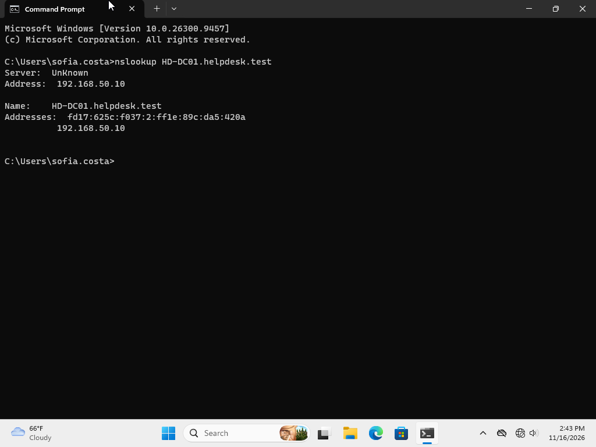

# HD-005 — Unable to resolve company network resource

**Scenario:** An HR employee cannot locate the department's network share by hostname.

## Objective

Distinguish DNS name resolution from basic IP and SMB connectivity; correct the client's DNS configuration.

## Diagnostic workflow

1. On HD-PC01, inspect addresses and resolvers using `ipconfig /all`.
2. Check basic connectivity to the domain controller using `ping 192.168.50.10` (note that firewalls can block ping).
3. Test the configured resolver: `nslookup HD-DC01.helpdesk.test`.
4. Test the correct server directly: `nslookup HD-DC01.helpdesk.test 192.168.50.10`.
5. Check SMB reachability from PowerShell: `Test-NetConnection 192.168.50.10 -Port 445`.
6. Identify a wrong/default resolver being selected (an unexpected `192.168.100.1` appeared during testing). Isolate the NAT adapter if needed.
7. Restore the client's internal DNS server to `192.168.50.10`, flush the resolver cache, re-run lookups, and reopen the HR share by hostname.

## Resolution / evidence

- Confirmed that the domain controller resolves correctly when queried at `192.168.50.10`.
- Confirmed SMB port 445 was reachable and, after correcting the client configuration, the shared folder was accessible again.
- A transient VirtualBox NAT-derived IPv6 AAAA record was visible in a screenshot; IPv4 resolution was working. This is a separate cleanup item and is not claimed as fully resolved.

**Lesson:** Connectivity to a host by IP and lookup of its name are different tests; use both before changing network settings.
